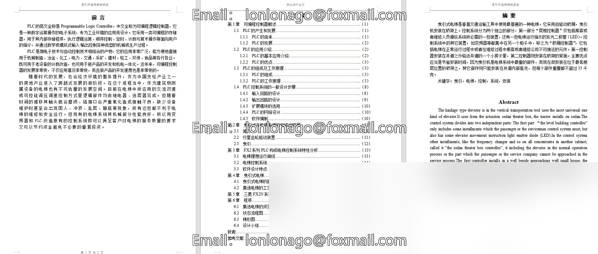
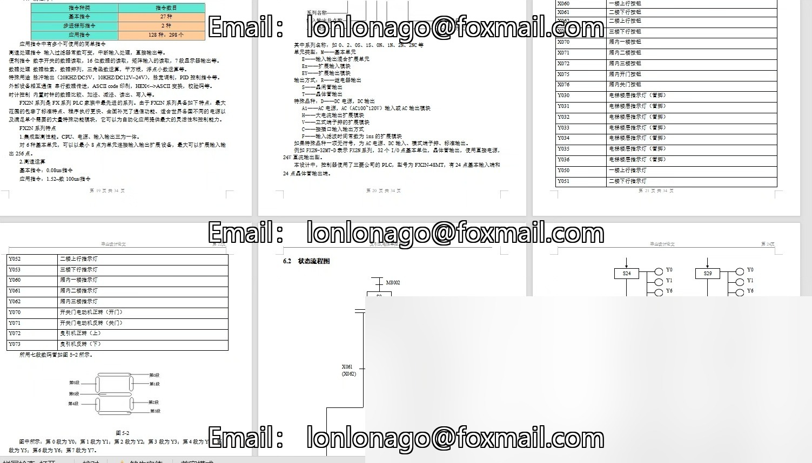

# System design for PLC-based inertia lift single-control and elevator system design based on PLC

## Body

Design of PLC-based single-controlled guiding elevator system; design of PLC-based elevator system; elevator system design; 464 documents only contain articles, for reference only.

The material covers a PLC-based drafting design for a pulling elevator with single-control and system design, includes Huayue design papers, and discusses elevator control systems.

<!-- AI_ENRICHED -->

## Images

## Payment

Here is a pay link on Stripe ( https://buy.stripe.com/3cs8yP7sY87d0vu9AB ). Please contact me lonlonago@foxmail.com after funding $89, and I will send you a complete data files , thank you!

